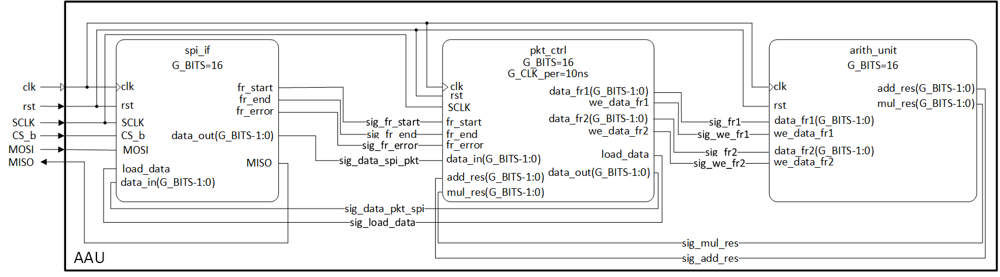

# Auxiliary Arithmetic Unit (AAU) - BPC-NDI

## Description
This repository contains the semester project for the **BPC-NDI** course at Brno University of Technology (BUT). The project implements an **Auxiliary Arithmetic Unit (AAU)** on a Xilinx Artix-7 FPGA. The AAU acts as an extension unit for a simple microcontroller (MCU), performing basic arithmetic operations (addition and multiplication). Communication between the MCU (Master) and AAU (Slave) is handled via a Serial Peripheral Interface (SPI).

## Team Members
| Name | Responsibility |
| :--- | :--- |
| [**Riabchuk Rostyslav**](https://github.com/Aztecus77) | [SPI Slave](./src/spi_if.vhd) |
| [**Daniil Yeriemieiev**](https://github.com/daniil-yeriemieiev) |  |

## Base Functions
*   **SPI Slave Communication**: Receives data and commands via SPI (MOSI) and transmits results back (MISO). Compatible with 10 kHz, 100 kHz, and 1 MHz clock frequencies.
*   **Packet Protocol**: Transactions are processed in packets (2 frames/numbers per packet). Results are sent in the subsequent packet.
*   **Fixed-Point Arithmetic**: Performs addition and multiplication using 16-bit signed numbers (8-bit integer, 8-bit fractional).
*   **Rounding & Saturation**: Implements "floor" rounding for operations and hard saturation (to `0x7FFF` or `0x8000`) in case of overflow.
*   **Error Handling**: Detects and ignores incomplete SPI frames. Implements a 1ms timeout for packet resets.

## Verification Matrix

*Legend:
- **R**: Review of Design
- **S**: Simulation on RTL level
- **A**: Analysis
- **REQ_AAU_G**: General requirements
- **REQ_AAU_F**: Functional requirements
- **REQ_AAU_I**: Interface requirements

| Completed | REQ ID | Name | Description | R | S | A | Requirement Verification | Notes/Comments |
| :---: | :--- | :--- | :--- | :---: | :---: | :---: | :--- | :--- |
| ✅ | **REQ_AAU_G_001** | Target technology | The Auxiliary Arithmetic Unit shall be designed for FPGA Xilinx Artix-7. | X | | | | |
| ✅ | **REQ_AAU_G_002** | Synchronous design | Design shall be fully synchronous, only one clock in the whole design is allowed. | X | | | In all processes within the execution units ([`spi_if`](./src/spi_if.vhd), [`pkt_ctrl`](./src/pkt_ctrl.vhd), [`arith_unit`](./src/arith_unit.vhd)), the sequential logic is strictly enclosed within `if rising_edge(clk) then` blocks. | Only statement `if rising_edge(clk) then` is allowed. |
| ✅ | **REQ_AAU_G_003** | Output signals | All output signals shall be glitch-free. | X | (X) | | In the [`spi_if`](./src/spi_if.vhd) module, data is shifted out to the `MISO` port directly from a D-flip-flop (`tx_shift` register) without traversing any combinational logic. | `MISO` must be driven directly by a register. |
| ✅ | **REQ_AAU_G_004** | Input signals | All input signals are asynchronous in nature and proper synchronization technique shall be implemented to ensure no metastability issues can appear. | X | (X) | | The [`spi_if`](./src/spi_if.vhd) module uses a two-stage flip-flop synchronizer chain (`p_sclk_sync`, `p_cs_sync`, `p_mosi_sync`) passing data through intermediate meta-registers to mitigate metastability. A separate set of processes (`p_sclk_edge`, etc.) registers the previous state to enable synchronous edge detection. | Splitting synchronization and edge-memory into separate processes provides clean modularity. |
| 🔳 | **REQ_AAU_G_005** | FSM Safe Implementation | All FSMs should be protected against environmental effects such as SEE to ensure no FSM can stuck in non-operational state. | X | (X) | | The `when others =>` clause is implemented in all FSMs to handle undefined states, routing them safely to a known IDLE/reset condition. | Synthesis attribute like `fsm_safe_state` can also be considered. |
| 🔳 | **REQ_AAU_G_006** | Documentation | As a minimum, following points shall be documented: Development flow, Description of design, Verification plan, Verification description, Verification report, Implementation report. | X | | | | |
| ✅ | **REQ_AAU_F_010** | Auxiliary Arithmetic Unit | The Arithmetic Unit shall perform two operations with signed numbers, addition and multiplication. | X | | | All mathematical signals inside [`arith_unit`](./src/arith_unit.vhd) utilize the standard VHDL `signed` type. | Standard (important: signed numbers). |
| 🔳 | **REQ_AAU_F_011** | Format of numbers | The AAU shall perform operations in fixed-point arithmetic with 16 bit numbers, where whole part is 8 bits and fractional part is 8 bits. | | X | | | Implicit in `signed(15 downto 0)`. Align bits properly after multiplication. |
| 🔳 | **REQ_AAU_F_012** | Number rounding | Where rounding of results of arithmetic operations is necessary, floor method shall be used. | | X | | | Floor rounding in 2's complement is simply truncating (dropping) the extra LSBs. |
| 🔳 | **REQ_AAU_F_013** | Overflow of arithmetic operations | When result of arithmetic operation overflows, the result shall be saturated to maximum positive or negative value (0x7FFF, 0x8000). | | X | | | Range: `[-128.0; 127.996]`. Saturated to `0x8000` or `0x7FFF`. |
| 🔳 | **REQ_AAU_I_020** | SPI clock frequency | The AAU interface shall be compatible with SPI clock (SCLK) 10 kHz, 100 kHz and 1 MHz. | | X | | | |
| 🔳 | **REQ_AAU_I_021** | Bit ordering | In data transfer, LSb shall be sent first. | | X | | | LSb first: shift incoming `MOSI` bit into MSb and shift the register right. |
| 🔳 | **REQ_AAU_I_022** | Incomplete frame | Frame with wrong number of bits shall be ignored. | | X | | | |
| 🔳 | **REQ_AAU_I_023** | Link reset | When reception of the second frame of a packet is not started in 1ms after the first frame was received, such packet shall be considered invalid. | | X | | | Requires a timer. Max counter value depends on the system `clk` frequency. |
| 🔳 | **REQ_AAU_I_024** | Packet format | Arithmetic results shall be sent out to master in the following order: 1. Sum 2. Product | | X | | | |

### Test Examples

- **REQ_AAU_F_011**:
    The Q8.8 format is achieved by multiplying a real number by $256 = 2^8$ (equivalent to an 8-bit left shift). Thus, sending the following inputs:
    - `MOSI_frame1` = 384 ($1.5 \times 256$)
    - `MOSI_frame2` = 576 ($2.25 \times 256$)
    
    The expected outputs are:
    - **Addition result:**
        - `MISO_sum` = 960 ($3.75 \times 256$)
    - **Multiplication result:**
        Multiplying two Q8.8 numbers yields an internal Q16.16 format, which must be shifted right by 8 bits to return to Q8.8.
        - $384 \times 576 = 221184$
        - $221184 / 256 = 864$
        - `MISO_product` = 864 ($3.375 \times 256$)

    *Quantization Error Note:* Choosing a number that does not yield an integer when multiplied by 256 (e.g., $2.2 \times 256 = 563.2$) results in quantization error. The testbench uses a `round` function to map it to the nearest integer before sending it to the FPGA:
    - `MOSI_frame1` = 563 ($\approx 563.2 = 2.2 \times 256$)
    - `MOSI_frame2` = 1178 ($\approx 1177.6 = 4.6 \times 256$)
    - `MISO_sum` = 1741 ($\approx 1740.8 = 6.8 \times 256$) -- $1741 / 256 = 6.800781$

- **REQ_AAU_F_012**:
    Using the quantized values from the F_011 example, we evaluate the rounding behavior of the internal hardware during multiplication:
    - `MOSI_frame1` = 563
    - `MOSI_frame2` = 1178
    - The raw 32-bit internal product is $563 \times 1178 = 663214$.
    - The exact division for shifting is $663214 / 256 = 2590.679688$.
    - The expected output is `MISO_product` = 2590. 
    The fact that the output is exactly 2590 (and not mathematically rounded up to 2591) proves that the hardware implements the **floor** rounding method by truncating the lower 8 bits.

- **REQ_AAU_F_013**:
    **Positive Overflow:**
    - `MOSI_frame1` = 25600 ($100.0 \times 256$)
    - `MOSI_frame2` = 12800 ($50.0 \times 256$)
    - `MISO_sum` = 38400 ($150.0 \times 256$) $\Rightarrow$ Exceeds positive limit, saturates to `0x7FFF`.
    - `MISO_product` = 327680000 / 256 = 1280000 ($5000.0 \times 256$) $\Rightarrow$ Exceeds positive limit, saturates to `0x7FFF`.
    
    *Fractional Limit Test:* The maximum representable value in Q8.8 is $+127.99609375$ (which is $(2^{15} - 1) / 256$). Adding just one minimum step ($0.0039$) causes an overflow:
    - `MOSI_frame1` = 32512 ($127.0 \times 256$)
    - `MOSI_frame2` = 256 ($1.0 \times 256$)
    - `MISO_sum` = 32768 ($128.0 \times 256$) $\Rightarrow$ Saturates to `0x7FFF` (32767).

    **Negative Overflow:**
    The minimum representable value in Q8.8 is $-128.0$ (`0x8000`).
    - `MOSI_frame1` = -25600 ($-100.0 \times 256$)
    - `MOSI_frame2` = -12800 ($-50.0 \times 256$)
    - `MISO_sum` = -38400 ($-150.0 \times 256$) $\Rightarrow$ Exceeds negative limit, saturates to `0x8000`.

- **REQ_AAU_I_020**: 
    Verified within a single testbench file. A timing constant (e.g., `SCLK_per`) will be manipulated directly in the VHDL test stimulus process. The test suite will be executed sequentially with `SCLK_per` set to `100 us` (10 kHz), `10 us` (100 kHz), and `1 us` (1 MHz). The module must successfully receive packets and output correct calculations under all three frequency conditions.

- **REQ_AAU_I_021**:
    Verified automatically across all tests. For instance, sending data with LSb first:
    - `MOSI_frame1` = 384
    - `MOSI_frame2` = 576
    Should yield:
    - `MISO_sum` = `0b0000_0011_1100_0000` = 960 
    - `MISO_product` = `0b0000_0011_0110_0000` = 864
    If the output value were sent MSb first instead, we would obtain:
    - MISO_sum = `0b0000_0011_1100_0000` = 960 (Match, due to binary symmetry)
    - MISO_product = `0b0000_0110_1100_0000` = 1728 (Error)
    
    *False-positive prevention:* Testing exclusively with symmetric binary patterns (e.g., `0` and `-1`) can mask bit-ordering errors. 
    - `MOSI_frame1` = `0b0000_0000_0000_0000` = 0
    - `MOSI_frame2` = `0b1111_1111_1111_1111` = -1
    The output would correctly be `-1` and `0` regardless of whether the shift register processes MSb or LSb first. Non-symmetric inputs (like 384 and 576) are strictly required to validate this requirement.

- **REQ_AAU_I_022**:
    Verified by deliberately terminating the `CS_b` signal prematurely (e.g., after 15 bits). 
    *Scenario:* A valid packet is sent, and calculations are stored. Then, an invalid packet with different values is sent. During this invalid transmission, the `MISO` line correctly shifts out the previous valid results. Upon detecting the bit-count error, the FSM ignores the new data, leaving the internal registers intact. The subsequent valid packet will extract the exact same mathematical results as before, proving the corrupted packet was ignored.

- **REQ_AAU_I_023**:
    Verified by manipulating delays between the first and second frames. 
    1. Delay = `500 us`: Packet is processed, new output generated.
    2. Delay = `999 us`: Packet is processed, new output generated.
    3. Delay = `1 ms`: Packet is processed, new output generated.
    4. Delay = `1.001 ms`: The 1 ms timeout expires. The FSM resets and invalidates the packet. Internal registers remain unchanged, and the previous calculations are preserved.
    Extended delays (`2 ms`, `3 ms`) can also be tested to ensure the timeout counter modulates/resets correctly.

- **REQ_AAU_I_024**:
    Verified automatically across all tests. The first 16 bits shifted out (`MISO_frame1`) must inherently contain the addition result, and the second 16 bits (`MISO_frame2`) must contain the multiplication result.

## Schematic

Top-level schematic of the complete board-level functionality. It shows the full system composition, the main interconnected blocks, and how the individual modules interact with each other and with the surrounding hardware on the FPGA platform.

Detailed implementation-oriented block diagram used during the design process. It specifies the ports, signal names, and interconnections of the developed subsystem and represents the actual working view of the project as a black-box interface description, without exposing the internal functional details of the individual blocks.

## RTL Design
The design follows a top-down architecture, separated into three main functional blocks:

1.  **SPI IF (`spi_if.vhd`)**: Handles the physical SPI layer. Contains edge detectors for `CS_b` and `SCLK`, and shift registers for serial-to-parallel (MOSI) and parallel-to-serial (MISO) data conversion.
2.  **Packet Controller (`pkt_ctrl.vhd`)**: Manages the communication protocol layer. Utilizes a Finite State Machine (FSM) to route incoming frames, track packet completeness, and manage the 1ms timeout timer.
3.  **Arithmetic Unit (`arith_unit.vhd`)**: The core processing unit. Contains input registers to store frame data, combination logic for addition and multiplication (with floor rounding and saturation), and output registers for the results.

