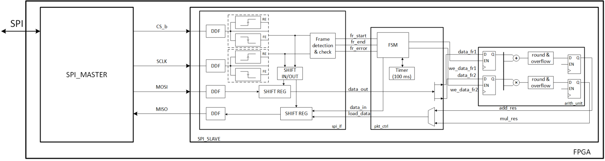
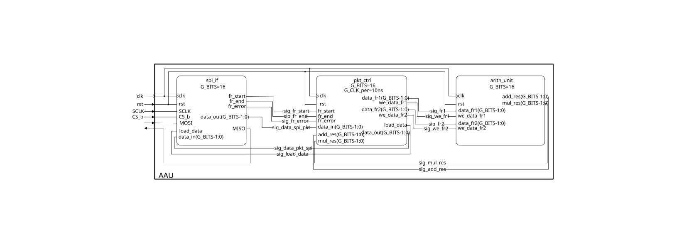

# Auxiliary Arithmetic Unit (AAU) - BPC-NDI

## Description
This repository contains the semester project for the **BPC-NDI** course at Brno University of Technology (BUT). The project implements an **Auxiliary Arithmetic Unit (AAU)** on a Xilinx Artix-7 FPGA. The AAU acts as an extension unit for a simple microcontroller (MCU), performing basic arithmetic operations (addition and multiplication). Communication between the MCU (Master) and AAU (Slave) is handled via a Serial Peripheral Interface (SPI).

## Team Members
| Name | Responsibility |
| :--- | :--- |
| [**Riabchuk Rostyslav**](https://github.com/Aztecus77) |  |
| [**Daniil Yeriemieiev**](https://github.com/daniil-yeriemieiev) |  |

## Base Functions
*   **SPI Slave Communication**: Receives data and commands via SPI (MOSI) and transmits results back (MISO). Compatible with 10 kHz, 100 kHz, and 1 MHz clock frequencies.
*   **Packet Protocol**: Transactions are processed in packets (2 frames/numbers per packet). Results are sent in the subsequent packet.
*   **Fixed-Point Arithmetic**: Performs addition and multiplication using 16-bit signed numbers (8-bit integer, 8-bit fractional).
*   **Rounding & Saturation**: Implements "floor" rounding for operations and hard saturation (to `0x7FFF` or `0x8000`) in case of overflow.
*   **Error Handling**: Detects and ignores incomplete SPI frames. Implements a 1ms timeout for packet resets.

## Verification Matrix

*Legend:
* **R**: Review of Design
* **S**: Simulation on RTL level
* **A**: Analysis
* **REQ_AAU_G**: General requirements
* **REQ_AAU_F**: Functional requirements
* **REQ_AAU_I**: Interface requirements

| Completed | REQ ID | Name | Description | R | S | A | Requirement Verification | Notes/Comments |
| :---: | :--- | :--- | :--- | :---: | :---: | :---: | :--- | :--- |
| - [x] | **REQ_AAU_G_001** | Target technology | The Auxiliary Arithmetic Unit shall be designed for FPGA Xilinx Artix-7. | X | | | | |
| - [ ] | **REQ_AAU_G_002** | Synchronous design | Design shall be fully synchronous, only one clock in the whole design is allowed. | X | | | | Only statement `if rising_edge(clk) then` is allowed. |
| - [ ] | **REQ_AAU_G_003** | Output signals | All output signals shall be glitch-free. | X | (X) | | | `MISO` must be driven directly by a register (D-FF), no combinational logic at the output. |
| - [ ] | **REQ_AAU_G_004** | Input signals | All input signals are asynchronous in nature and proper synchronization technique shall be implemented to ensure no metastability issues can appear. | X | (X) | | | Use a 2-stage D-FF synchronizer chain for all async inputs (`CS_b`, `SCLK`, `MOSI`). |
| - [ ] | **REQ_AAU_G_005** | FSM Safe Implementation | All FSMs should be protected against environmental effects such as SEE to ensure no FSM can stuck in non-operational state. | X | (X) | | | Use `when others =>` for reset transition, or a synthesis attribute like `fsm_safe_state` |
| - [ ] | **REQ_AAU_G_006** | Documentation | As a minimum, following points shall be documented: Development flow, Description of design, Verification plan, Verification description, Verification report, Implementation report. | X | | | | |
| - [ ] | **REQ_AAU_F_010** | Auxiliary Arithmetic Unit | The Arithmetic Unit shall perform two operations with signed numbers, addition and multiplication. | X | | | | standard (important: signed numbers) |
| - [ ] | **REQ_AAU_F_011** | Format of numbers | The AAU shall perform operations in fixed-point arithmetic with 16 bit numbers, where whole part is 8 bits and fractional part is 8 bits. | | X | | | Implicit in `signed(15 downto 0)`. Align bits properly after multiplication. |
| - [ ] | **REQ_AAU_F_012** | Number rounding | Where rounding of results of arithmetic operations is necessary, floor method shall be used. | | X | | | Floor rounding in 2's complement is simply truncating (dropping) the extra LSBs. |
| - [ ] | **REQ_AAU_F_013** | Overflow of arithmetic operations | When result of arithmetic operation overflows, the result shall be saturated to maximum positive or negative value (0x7FFF, 0x8000). | | X | | | [0x8000; 0x7FFF]. Detect by checking sign bits: pos+pos!=neg, neg+neg!=pos. |
| - [ ] | **REQ_AAU_I_020** | SPI clock frequency | The AAU interface shall be compatible with SPI clock (SCLK) 10 kHz, 100 kHz and 1 MHz. | | X | | | |
| - [ ] | **REQ_AAU_I_021** | Bit ordering | In data transfer, LSb shall be sent first. | | X | | | LSb first: shift incoming `MOSI` bit into MSb and shift the register right |
| - [ ] | **REQ_AAU_I_022** | Incomplete frame | Frame with wrong number of bits shall be ignored. | | X | | | |
| - [ ] | **REQ_AAU_I_023** | Link reset | When reception of the second frame of a packet is not started in 1ms after the first frame was received, such packet shall be considered invalid. | | X | | | Requires a timer. Max counter value depends on the system `clk` frequency to reach 1ms |
| - [ ] | **REQ_AAU_I_024** | Packet format | Arithmetic results shall be sent out to master in the following order: 1. Sum 2. Product | | X | | | |

## Schematic

Top-level schematic of the complete board-level functionality. It shows the full system composition, the main interconnected blocks, and how the individual modules interact with each other and with the surrounding hardware on the FPGA platform.

Detailed implementation-oriented block diagram used during the design process. It specifies the ports, signal names, and interconnections of the developed subsystem and represents the actual working view of the project as a black-box interface description, without exposing the internal functional details of the individual blocks.

## RTL Design
The design follows a top-down architecture, separated into three main functional blocks:

1.  **SPI IF (`spi_if.vhd`)**: Handles the physical SPI layer. Contains edge detectors for `CS_b` and `SCLK`, and shift registers for serial-to-parallel (MOSI) and parallel-to-serial (MISO) data conversion.
2.  **Packet Controller (`pkt_ctrl.vhd`)**: Manages the communication protocol layer. Utilizes a Finite State Machine (FSM) to route incoming frames, track packet completeness, and manage the 1ms timeout timer.
3.  **Arithmetic Unit (`arith_unit.vhd`)**: The core processing unit. Contains input registers to store frame data, combination logic for addition and multiplication (with floor rounding and saturation), and output registers for the results.

